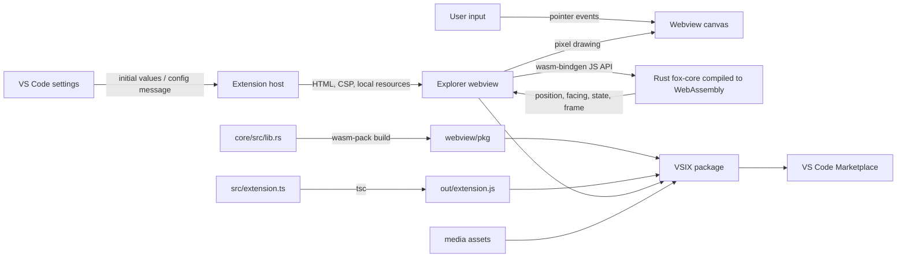

# CodeFox Architecture

## Purpose and scope

CodeFox is a Visual Studio Code extension that hosts a small interactive fox in
the Explorer sidebar. It is a client-side extension: the animation and game
simulation run locally in a VS Code webview, with no application server or
remote service.

This document describes the current implementation, developer workflow, CI,
and release path. Where a step is manual, it is identified as such rather than
implied to be automated.

## System overview

### Runtime components

| Component / technology | Role |
| --- | --- |
| Visual Studio Code Extension API | Registers the Explorer view and `Fox: Show` command, reads settings, and creates/configures the webview. |
| TypeScript (`src/extension.ts`) | Extension-host entry point. Owns the webview provider, startup behavior, resource URIs, Content Security Policy (CSP), and configuration updates. |
| VS Code webview | Isolated UI surface embedded in the Explorer sidebar. It loads only packaged local resources and runs the renderer with scripts enabled under a nonce-based CSP. |
| JavaScript (`webview/main.js`) | Webview renderer. Loads the generated WASM module, sends pointer input to the simulation, handles resizing and settings messages, runs the animation frame loop, and paints the fox using Canvas 2D. |
| Rust (`core/src/lib.rs`) | Owns fox simulation and interaction rules: movement, jumps, sprinting, crouching, wandering, sleeping, boundaries, and animation state. |
| `wasm-bindgen` and WebAssembly | Expose the Rust `Fox` API to browser JavaScript and provide the portable simulation binary executed inside the webview. |
| HTML, CSS, Canvas 2D | The extension host supplies the webview document and styles; Canvas 2D draws the pixel-art fox and ground line. The sprite is defined as pixel rows in `webview/main.js`. |
| TypeScript compiler (`tsc`) | Compiles the extension-host TypeScript to `out/extension.js`, the entry point referenced by the extension manifest. |
| `wasm-pack` and Cargo | Compile the Rust library for `wasm32-unknown-unknown` and generate the JavaScript bindings and WASM assets in `webview/pkg`. |
| `@vscode/vsce` | Packages the compiled extension and webview assets into a VSIX for local installation or Marketplace publication. |
| GitHub Actions | Runs the build and Rust test workflow on pushes, pull requests, or manual dispatch, then uploads the VSIX as a workflow artifact. It does not publish to the Marketplace. |

## Runtime and data flow

1. VS Code activates the extension after startup (`onStartupFinished`).
2. `activate` registers the `codefox.view` Explorer webview provider, the
   `codefox.show` command, and a configuration-change listener. If
   `codefox.showOnStartup` is enabled, it focuses the view.
3. When VS Code resolves the view, `FoxViewProvider` sets the webview's local
   resource root and scripts option, then serves the HTML document. The
   document includes the initial scale and wander settings, a per-document
   script nonce, and a CSP that restricts resources to the webview's local
   source (plus the explicitly allowed data images).
4. `webview/main.js` dynamically imports `webview/pkg/fox_core.js`, which
   instantiates `fox_core_bg.wasm`. If loading fails, the webview shows an
   error in the view.
5. After initialization, JavaScript creates a Rust `Fox` instance using the
   canvas width and a random seed. Pointer events call the WASM API. Each
   animation frame advances the simulation with elapsed milliseconds and reads
   its position, direction, state, and frame for drawing.
6. On resize, the renderer updates canvas dimensions, device-pixel scaling,
   simulation world width, and drawing coordinates.
7. When a `codefox` setting changes, the extension host sends a `config`
   message to the webview. The renderer applies the updated scale and wander
   preference without restarting the extension.

The extension host and webview communicate through VS Code's webview message
API. The current message flow is host-to-webview configuration; direct input
and simulation calls remain within the webview and WASM module.

## State and settings

The fox simulation is in-memory state owned by the webview's Rust `Fox`
instance. It is not persisted between webview reloads or extension restarts.
The view is registered with `retainContextWhenHidden`, so VS Code retains its
webview context while hidden when possible.

| Setting | Default | Effect |
| --- | --- | --- |
| `codefox.showOnStartup` | `true` | Focus the Fox Explorer view after activation. |
| `codefox.scale` | `4` | Pixel scale used to size the fox; manifest bounds are 2 through 8. |
| `codefox.wander` | `true` | Enable autonomous movement and sleeping. |

Clicking makes the fox jump, a double-click starts a sprint, and holding the
pointer crouches until release. When wandering is enabled, the fox chooses
whether to walk and sleeps after 30 seconds without user input.

## Repository map

| Path | Responsibility |
| --- | --- |
| `src/extension.ts` | Extension activation, view provider, command, settings, webview HTML, and CSP. |
| `webview/main.js` | Canvas renderer, pointer/resize events, webview message handling, and frame loop. |
| `webview/pkg/` | Generated wasm-bindgen JavaScript, type declarations, and WebAssembly binary. Regenerated by the build; do not treat it as the Rust source of truth. |
| `core/src/lib.rs` | Rust simulation implementation and unit tests. |
| `core/Cargo.toml` / `core/Cargo.lock` | Rust crate metadata and locked Rust dependency versions. |
| `media/` | Extension icon, logo, and fox artwork used by the project and extension manifest. |
| `package.json` / `package-lock.json` | Extension manifest, VS Code contributions, Node scripts, and locked npm dependencies. |
| `tsconfig.json` | TypeScript compiler configuration. |
| `.vscodeignore` | Files excluded when creating the VSIX. Source TypeScript and Rust sources are omitted; compiled output, generated WASM, webview code, and media are needed in the package. |
| `.github/workflows/ci.yml` | CI build, Rust tests, VSIX packaging, and artifact upload. |

## Development and verification workflow

### Prerequisites

- Visual Studio Code 1.85 or newer.
- Node.js 18 or newer (CI currently uses Node.js 20).
- Rust stable, the `wasm32-unknown-unknown` target, and `wasm-pack` to build
  from source.

### Local workflow

1. Install JavaScript dependencies with `npm ci` (or `npm install` when
   intentionally updating the lockfile).
2. Build the WASM module and compile the extension with `npm run build`.
   `build:wasm` runs `wasm-pack build core --target web` in release mode and
   writes generated files to `webview/pkg`; `compile` runs `tsc` and writes
   extension code to `out`.
3. Run Rust simulation tests with
   `cargo test --manifest-path core/Cargo.toml`.
4. Open the repository in VS Code and press F5 to launch the Extension
   Development Host. Exercise the Fox view, command, interactions, and settings
   there.
5. Run `npm run package` to create a VSIX. The `vscode:prepublish` lifecycle
   script runs the build before `vsce package`.

The root npm scripts currently provide TypeScript compilation, WASM build,
combined build, and VSIX packaging; there is no separate JavaScript test,
lint, or webview test script configured.

## Continuous integration

`.github/workflows/ci.yml` runs for pushes, pull requests, and manual
`workflow_dispatch`. The workflow:

1. Checks out the repository.
2. Sets up Node.js 20 with npm dependency caching.
3. Sets up stable Rust with the WebAssembly target and installs `wasm-pack`.
4. Installs the locked npm dependencies using `npm ci`.
5. Runs `cargo test --manifest-path core/Cargo.toml`.
6. Runs `npm run package`, which builds the WASM and TypeScript outputs and
   packages the extension.
7. Uploads the generated `codefox-*.vsix` as the `codefox-vsix` Actions
   artifact.

The workflow has read-only repository-content permissions. It verifies and
stores a build artifact; it does not create a GitHub Release, tag a version,
or publish to the VS Code Marketplace.

## Packaging, release, and deployment

### VSIX contents and local installation

The distributable is a VSIX created by `@vscode/vsce`. Packaging relies on
`.vscodeignore` to omit development files such as `src/`, `core/`,
`node_modules/`, and source maps while retaining the compiled extension and
its runtime resources, including `webview/main.js`, `webview/pkg/`, and
`media/`.

To validate a package locally, build it with `npm run package`, then install
the resulting VSIX in VS Code (for example, through **Extensions: Install from
VSIX...**) and verify the installed extension.

### Current Marketplace release path

Marketplace publication is a maintainer action, not a CI deployment:

1. Update the extension version in `package.json` and document the release in
   `CHANGELOG.md`.
2. Run the Rust tests and package/build workflow; inspect and install the VSIX
   to validate the release candidate.
3. Publish through the Visual Studio Marketplace publisher portal, or
   authenticate as the configured publisher and run `npx vsce publish`.
4. Confirm the published version and marketplace listing.

The extension manifest identifies the publisher as `KrushnaKoshatwar`; the
publishing identity must have permission for that Marketplace publisher. Do
not put a Personal Access Token or other publishing secret in the repository.
Automating publication would require a separately configured protected secret,
release trigger, and explicit publishing job; none is currently present.

## Operational and security boundaries

- The extension has no backend, telemetry service, database, or runtime
  network dependency. Simulation and rendering execute locally.
- The webview can run scripts because the renderer needs them, but its document
  uses a nonce and a restrictive CSP. Keep the local resource root limited to
  the webview assets and avoid broadening the policy without a concrete need.
- `webview/pkg/` is generated build output that ships with the extension. Build
  it from the Rust source before packaging; do not edit the generated bindings
  as a substitute for changing `core/src/lib.rs`.
- The host currently sends configuration to the webview, not arbitrary source
  or executable code. Preserve explicit message shapes if new host/webview
  interactions are added.
- `wasm-unsafe-eval` is present in the CSP because WebAssembly instantiation
  requires it in this webview environment.

## Architectural constraints and extension points

- Keep simulation rules in the Rust core and presentation/input concerns in
  the webview renderer.
- Keep extension-host responsibilities focused on VS Code integration,
  configuration, and webview lifecycle.
- Changes to the Rust/JavaScript boundary must be reflected in the
  wasm-bindgen API, generated `webview/pkg/` output, and webview calls.
- The extension manifest's contributions, `package.json` scripts,
  `.vscodeignore`, CI workflow, and this document should stay consistent when
  adding settings, commands, runtime assets, tests, or release automation.
