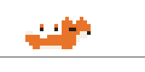

# CodeFox

<div align="center">
  
</div>

<p align="center">
  <a href="https://github.com/Oaklaan/CodeFox/releases/tag/v0.0.3"></a>
  <a href="https://github.com/Oaklaan/CodeFox/actions/workflows/ci.yml"></a>
  <a href="https://marketplace.visualstudio.com/items?itemName=KrushnaKoshatwar.codefox"></a>
  
  
</p>

A tiny pixel fox that roams the Explorer sidebar of Visual Studio Code while you work.

- **Click** – jump (he turns toward where you clicked)
- **Double-click** – sprint
- **Click and hold** – crouch until you let go
- Leave him alone for 30 s and he falls asleep.

The **Fox** view opens automatically in the Explorer sidebar alongside your files when VS Code starts. Run **Fox: Show** from the Command Palette to focus it again.

## Requirements

- Visual Studio Code 1.85 or newer
- Node.js 18 or newer

The published extension includes its compiled WebAssembly files; Rust is only needed to build the project from source.

## Develop

To build from source, install Rust stable and the WebAssembly target and `wasm-pack`:

```powershell
rustup target add wasm32-unknown-unknown
cargo install wasm-pack
```

On Windows, installing `wasm-pack` from source may require the Visual Studio C++ Build Tools. Then, from the project directory:

```bash
npm install
npm run build
```

Open the folder in VS Code and press **F5** to launch the Extension Development Host. In that window, find **Fox** in the Explorer sidebar or run **Fox: Show**.

Run the Rust game-logic tests with:

```bash
cargo test --manifest-path core/Cargo.toml
```

## Settings

- `codefox.scale`: fox pixel scale (2–8, default 4).
- `codefox.wander`: enable autonomous walking and sleeping (default `true`).
- `codefox.showOnStartup`: automatically open the Fox view on startup (default `true`).

## Package and publish

Build and create a VSIX package:

```bash
npm run build
npm run package
```

Install the generated `.vsix` locally in VS Code to test it. To publish, sign in to the [Visual Studio Marketplace publisher portal](https://marketplace.visualstudio.com/manage) and upload the VSIX, or publish with `npx vsce publish`.

## License

CodeFox is licensed under the MIT License. See [LICENSE.md](./LICENSE.md).
